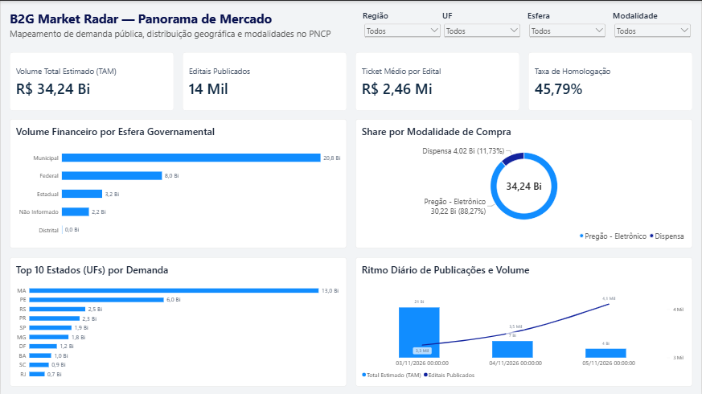
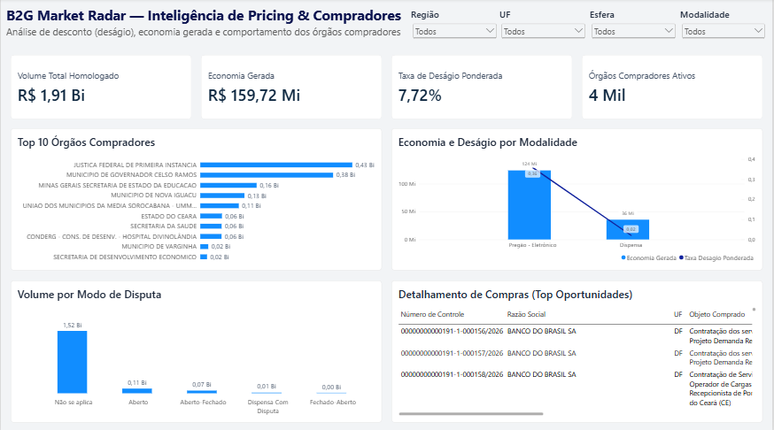
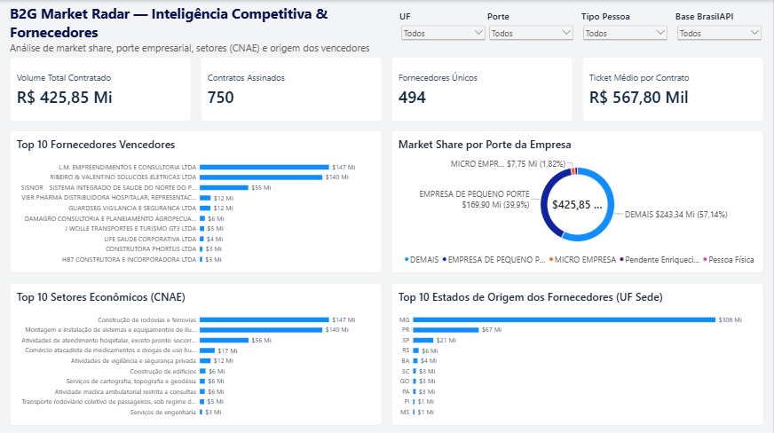
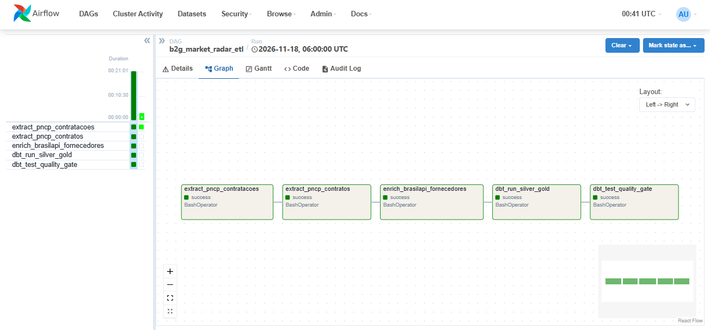

# B2G Market Radar — Commercial Intelligence in Public Procurement

> 🇺🇸 **English** | 🇧🇷 [Leia em Português](README.pt-BR.md)

An end-to-end **Data Engineering and Business Intelligence** platform that transforms open data from Brazil's **National Public Procurement Portal (PNCP)** and **BrasilAPI** into actionable competitive intelligence for companies selling to the public sector (B2G).

---

## 1. Business Problem

Private companies participating in public tenders often lack visibility into where demand is concentrated, how aggressively competitors price their bids, and which government agencies hold the largest budgets. This product answers **4 strategic questions**:

1. **Total Addressable Market (TAM):** What is the contracted financial volume by State (UF), government sphere (Federal, State, Municipal), and procurement modality?
2. **Competitiveness & Pricing:** What is the average discount rate (*deságio*) between the agency's estimated budget and the final awarded value?
3. **Competitor Analysis:** Which companies (CNPJs) hold the largest market share, contract volume, and economic sector (CNAE) presence?
4. **Seasonality & Pipeline:** How are public expenditures distributed over time, and what is the conversion rate from published notices to awarded contracts?

---

## 2. Solution Architecture

The pipeline implements a **Medallion Architecture** (`Bronze → Silver → Gold`) backed by PostgreSQL, incremental processing, and automated quality gates:

```text
┌─────────────────────────┐      ┌──────────────────────────┐
│   PNCP Public APIs      │      │       BrasilAPI          │
│ • /v1/contratacoes      │      │ • /api/cnpj/v1/{cnpj}    │
│ • /v1/contratos         │      │   (CNAE, Size, State)    │
└───────────┬─────────────┘      └────────────┬─────────────┘
            │                                 │
            └────────────────┬────────────────┘
                             ▼
            ┌─────────────────────────────────┐
            │   Python Ingestion Layer        │
            │ • Watermark incremental extract │
            │ • Exponential backoff retries   │
            │ • Audit logging (pipeline_runs) │
            └────────────────┬────────────────┘
                             ▼
┌─────────────────────────────────────────────────────────────────────────┐
│                     PostgreSQL Data Warehouse (Docker)                  │
│                                                                         │
│  ┌───────────────────┐   ┌───────────────────┐   ┌───────────────────┐  │
│  │   BRONZE Schema   │   │   SILVER Schema   │   │    GOLD Schema    │  │
│  │  Raw JSONB events │──▶│  dbt Incremental  │──▶│    Star Schema    │  │
│  │  & API snapshots  │   │  (delete+insert)  │   │  4 Dims + 2 Facts │  │
│  └───────────────────┘   └───────────────────┘   └─────────┬─────────┘  │
└────────────────────────────────────────────────────────────┼────────────┘
                                                             │
            ┌────────────────────────────────────────────────┤
            ▼                                                ▼
┌───────────────────────┐                        ┌───────────────────────┐
│   Power BI (.pbip)    │                        │  dbt Docs Lineage     │
│  3 Executive Pages    │                        │  Static Data Catalog  │
└───────────────────────┘                        └───────────────────────┘
```

* **Bronze Layer (`bronze`):** Stores raw API payloads in `JSONB` format alongside ingestion timestamps, ensuring full schema evolution resilience and historical auditability.
* **Silver Layer (`silver`):** Incremental `dbt` models (`delete+insert` strategy) that deduplicate records, cast types, normalize strings/CNPJs, and flatten nested JSON structures.
* **Gold Layer (`gold`):** Dimensional **Star Schema** optimized for BI analytics (`dim_orgao`, `dim_localidade`, `dim_modalidade`, `dim_fornecedor`, `fato_contratacoes`, and `fato_contratos`).

---

## 3. Tech Stack

* **Ingestion & Enrichment:** Python 3.11, `httpx`, `SQLAlchemy`, `psycopg2`
* **Data Warehouse:** PostgreSQL 16 (Containerized via Docker)
* **Transformation & Modeling:** `dbt Core` (`dbt-postgres`) with incremental models and Star Schema modeling
* **Orchestration & CI/CD:** Apache Airflow (task-level DAG) & GitHub Actions (automated CI tests + daily cron pipeline)
* **Data Quality & Observability:** `pytest` unit test suite, `dbt` schema/singular tests, custom outlier detection rules, and `audit.pipeline_runs` execution tracking
* **Business Intelligence:** Power BI Desktop saved in developer-friendly **`.pbip` (Power BI Project)** format for Git version control

---

## 4. Engineering & Data Quality Highlights

1. **Incremental Watermark Extraction:** Instead of hardcoded date filters, the Python extractors query `audit.pipeline_runs` to retrieve the last successful run window and apply a 2-day safety lookback to capture late bid awards (*homologações*).
2. **Multi-Source Entity Enrichment:** Joins tender notices (`/v1/contratacoes`) and signed contracts (`/v1/contratos`) with **BrasilAPI** to enrich winning suppliers with CNAE economic sector, company size (*ME, EPP, Large*), and headquarters state using database-backed caching.
3. **Real-World Anomaly & Outlier Isolation:** Government open data often contains human-entry errors (such as symbolic `R$ 1.00` estimates or missing decimal points). Rather than deleting records, the Gold layer flags anomalies via `is_outlier_valor`, preserving raw auditability while ensuring accurate discount (*deságio*) metrics.
4. **Automated Lineage & Testing:** Every `git push` triggers `pytest` unit tests and `dbt parse` validation in GitHub Actions, while scheduled runs execute end-to-end quality gates and rebuild the static `dbt docs` data catalog.

---

## 5. Executive Dashboards (Power BI `.pbip`)

### Page 1 — Market Overview (*Panorama de Mercado*)
Maps Total Addressable Market (TAM), published tenders, approval rates, federal/state/municipal distribution, and procurement modalities.



### Page 2 — Pricing & Buyer Intelligence (*Inteligência de Pricing & Compradores*)
Evaluates realized savings (*economia gerada*), weighted discount rates (*deságio*) after outlier filtering, top purchasing agencies, and bidding dispute modes.



### Page 3 — Competitive Intelligence & Suppliers (*Inteligência Competitiva & Fornecedores*)
Analyzes winning suppliers, market share by company size (ME/EPP vs. Large Enterprises), top economic sectors (CNAE), and supplier geographic origin.



---

## 6. Orchestration & CI/CD

The Apache Airflow DAG (`b2g_market_radar_etl`) decouples extraction, enrichment, transformation, and data quality gates into independent tasks with automatic retries:



---

## 7. Repository Structure

```text
b2g-market-radar/
├── .github/workflows/       # GitHub Actions CI/CD & daily scheduled pipeline
├── assets/                  # Dashboard and orchestration screenshots
├── bi/                      # Power BI Project (.pbip) semantic model & reports
├── docker/                  # Dockerfile, Dockerfile.airflow, and docker-compose.yml
├── docs/                    # Static dbt docs catalog (GitHub Pages ready)
├── ingestion/               # Incremental extractors (PNCP, BrasilAPI) & audit logger
├── orchestration/dags/      # Apache Airflow DAG definition
├── scripts/                 # Unified end-to-end pipeline runner
├── tests/                   # Pytest unit tests (pagination, retries, watermarks)
├── transformation/          # dbt Core project (Silver incremental + Gold Star Schema)
├── pyproject.toml           # Pytest configuration
└── requirements.txt         # Python dependencies
```

---

## 8. Quickstart

### Option A: Run via Docker Compose (Recommended)
```bash
# 1. Start PostgreSQL Data Warehouse
docker compose -f docker/docker-compose.yml up -d

# 2. Build and execute the full ETL + dbt pipeline container
docker compose -f docker/docker-compose.yml --profile pipeline build
docker compose -f docker/docker-compose.yml --profile pipeline run --rm etl-pipeline

# 3. (Optional) Launch Apache Airflow UI at http://localhost:8080 (admin / admin)
docker compose -f docker/docker-compose.yml --profile airflow up -d --build
```

### Option B: Run Locally
```bash
python -m venv .venv
source .venv/bin/activate  # On Windows: .venv\Scripts\Activate.ps1
pip install -r requirements.txt

# Run unit tests
pytest -v

# Execute end-to-end pipeline
python scripts/run_pipeline.py
```