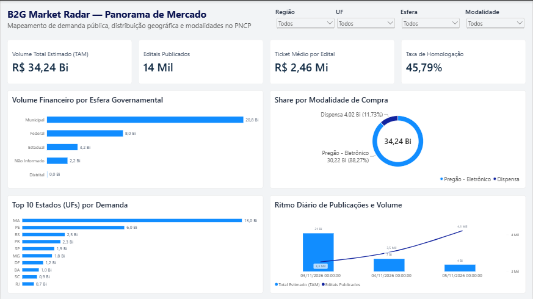
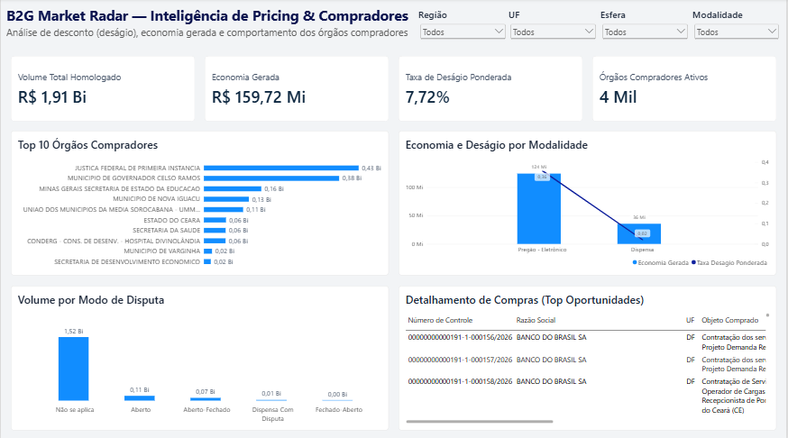
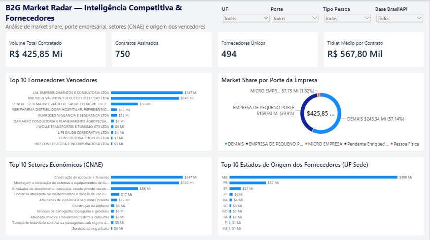
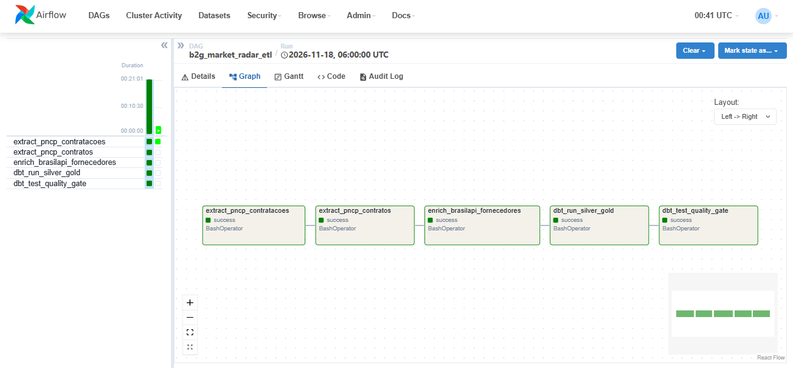

# B2G Market Radar — Inteligência Comercial em Licitações Públicas

> 🇺🇸 [Read in English](README.md) | 🇧🇷 **Português**

Plataforma ponta a ponta de **Engenharia e Análise de Dados** que transforma dados abertos do **Portal Nacional de Contratações Públicas (PNCP)** e da **BrasilAPI** em inteligência competitiva para empresas que vendem para o setor público (B2G).

---

## 1. Problema de Negócio

Empresas privadas que participam de licitações enfrentam baixa visibilidade sobre onde está a demanda, qual a agressividade de preços dos concorrentes e quais órgãos concentram orçamento. Este produto responde a **4 perguntas estratégicas**:

1. **Tamanho de Mercado (TAM):** Qual o volume financeiro contratado por UF, esfera (Federal, Estadual, Municipal) e modalidade?
2. **Competitividade e Pricing:** Qual a taxa média de desconto (deságio) entre o valor estimado pelo órgão e o valor homologado?
3. **Análise de Concorrência:** Quais empresas (CNPJs) detêm o maior *market share*, volume de contratos e atuação por setor econômico (CNAE)?
4. **Sazonalidade e Pipeline:** Como os gastos se distribuem ao longo dos meses e qual a taxa de conversão entre editais publicados e compras homologadas?

---

## 2. Arquitetura da Solução

O pipeline implementa uma **Arquitetura Medallion** (`Bronze → Silver → Gold`) sobre PostgreSQL, com carga incremental, auditoria de execuções e testes automatizados de qualidade:

```text
┌─────────────────────────┐      ┌──────────────────────────┐
│   APIs Públicas PNCP    │      │       BrasilAPI          │
│ • /v1/contratacoes      │      │ • /api/cnpj/v1/{cnpj}    │
│ • /v1/contratos         │      │   (CNAE, Porte, UF)      │
└───────────┬─────────────┘      └────────────┬─────────────┘
            │                                 │
            └────────────────┬────────────────┘
                             ▼
            ┌─────────────────────────────────┐
            │   Camada de Ingestão (Python)   │
            │ • Extração incremental watermark│
            │ • Retries com exponential backoff│
            │ • Auditoria (audit.pipeline_runs)│
            └────────────────┬────────────────┘
                             ▼
┌─────────────────────────────────────────────────────────────────────────┐
│                     PostgreSQL Data Warehouse (Docker)                  │
│                                                                         │
│  ┌───────────────────┐   ┌───────────────────┐   ┌───────────────────┐  │
│  │   Schema BRONZE   │   │   Schema SILVER   │   │    Schema GOLD    │  │
│  │  JSONB bruto das  │──▶│  dbt Incremental  │──▶│    Star Schema    │  │
│  │  APIs públicas    │   │  (delete+insert)  │   │  4 Dims + 2 Fatos │  │
│  └───────────────────┘   └───────────────────┘   └─────────┬─────────┘  │
└────────────────────────────────────────────────────────────┼────────────┘
                                                             │
            ┌────────────────────────────────────────────────┤
            ▼                                                ▼
┌───────────────────────┐                        ┌───────────────────────┐
│   Power BI (.pbip)    │                        │  dbt Docs Lineage     │
│ 3 Páginas Executivas  │                        │  Catálogo de Dados    │
└───────────────────────┘                        └───────────────────────┘
```

* **Camada Bronze (`bronze`):** Armazena as respostas brutas das APIs em formato `JSONB` com timestamp de extração, garantindo resiliência a mudanças de schema e rastreabilidade histórica.
* **Camada Silver (`silver`):** Modelos incrementais no `dbt` (estratégia `delete+insert`) responsáveis por deduplicação, tipagem forte, padronização de CNPJs e extração dos campos aninhados.
* **Camada Gold (`gold`):** Modelagem dimensional em **Star Schema** pronta para consumo analítico (`dim_orgao`, `dim_localidade`, `dim_modalidade`, `dim_fornecedor`, `fato_contratacoes` e `fato_contratos`).

---

## 3. Stack Tecnológica

* **Ingestão & Enriquecimento:** Python 3.11, `httpx`, `SQLAlchemy`, `psycopg2`
* **Data Warehouse:** PostgreSQL 16 (containerizado via Docker)
* **Transformação & Modelagem:** `dbt Core` (`dbt-postgres`) com modelos incrementais e Star Schema
* **Orquestração & CI/CD:** Apache Airflow (DAG granular por tarefa) e GitHub Actions (CI automático + agendamento diário)
* **Qualidade de Dados & Observabilidade:** Suíte de testes unitários com `pytest`, testes singulares/schema no `dbt`, detecção de *outliers* de preços e tabela de auditoria `audit.pipeline_runs`
* **Business Intelligence:** Power BI Desktop versionado no formato **`.pbip` (Power BI Project)** para controle de versão no Git

---

## 4. Diferenciais de Engenharia & Qualidade de Dados

1. **Extração Incremental por Watermark:** Os extratores em Python consultam `audit.pipeline_runs` para identificar a última janela extraída com sucesso e aplicam um *lookback* de segurança de 2 dias para capturar homologações e atualizações tardias.
2. **Enriquecimento Multi-Fonte:** Cruza editais (`/v1/contratacoes`) e contratos assinados (`/v1/contratos`) com a **BrasilAPI**, enriquecendo cada fornecedor vencedor com CNAE, porte empresarial (*ME, EPP, Demais*) e UF de sede com cache incremental no banco.
3. **Isolamento de Outliers na Fonte:** Bases públicas possuem erros humanos de digitação (como valores estimados simbólicos de `R$ 1,00`). Em vez de apagar registros, a camada Gold sinaliza anomalias via flag `is_outlier_valor`, preservando auditabilidade e garantindo precisão nas métricas de economia e deságio.
4. **Linhagem & Quality Gates Automatizados:** Todo `git push` aciona validações com `pytest` e `dbt parse` no GitHub Actions, enquanto execuções agendadas atualizam o catálogo interativo do `dbt docs`.

---

## 5. Dashboards Executivos (Power BI `.pbip`)

### Página 1 — Panorama de Mercado
Mapeia o Volume Total Estimado (TAM), editais publicados, taxa de homologação, distribuição por esfera governamental e modalidades de compra.



### Página 2 — Inteligência de Pricing & Compradores
Analisa a economia gerada, taxa de deságio ponderada (com filtro de *outliers*), principais órgãos compradores e modos de disputa.



### Página 3 — Inteligência Competitiva & Fornecedores
Apresenta o ranking de empresas vencedoras, *market share* por porte empresarial, principais setores econômicos (CNAE) e estados de origem dos fornecedores.



---

## 6. Orquestração & CI/CD

A DAG do Apache Airflow (`b2g_market_radar_etl`) separa extração, enriquecimento, transformação dimensional e testes de qualidade em tarefas independentes com *retry* automático:



---

## 7. Estrutura do Repositório

```text
b2g-market-radar/
├── .github/workflows/       # GitHub Actions CI/CD e agendamento diário
├── assets/                  # Capturas de tela dos dashboards e da DAG
├── bi/                      # Projeto Power BI (.pbip) com modelo semântico e relatórios
├── docker/                  # Dockerfile, Dockerfile.airflow e docker-compose.yml
├── docs/                    # Catálogo estático do dbt docs (pronto para GitHub Pages)
├── ingestion/               # Extratores incrementais (PNCP, BrasilAPI) e auditoria
├── orchestration/dags/      # Definição da DAG do Apache Airflow
├── scripts/                 # Orquestrador unificado do pipeline ponta a ponta
├── tests/                   # Testes unitários com pytest (paginação, retries, watermark)
├── transformation/          # Projeto dbt Core (Silver incremental + Gold Star Schema)
├── pyproject.toml           # Configuração do pytest
└── requirements.txt         # Dependências Python
```

---

## 8. Como Executar

### Opção A: Via Docker Compose (Recomendado)
```bash
# 1. Subir o PostgreSQL Data Warehouse
docker compose -f docker/docker-compose.yml up -d

# 2. Construir e executar o pipeline completo (Python + dbt)
docker compose -f docker/docker-compose.yml --profile pipeline build
docker compose -f docker/docker-compose.yml --profile pipeline run --rm etl-pipeline

# 3. (Opcional) Subir a interface do Apache Airflow em http://localhost:8080 (admin / admin)
docker compose -f docker/docker-compose.yml --profile airflow up -d --build
```

### Opção B: Execução Local
```bash
python -m venv .venv
.venv\Scripts\Activate.ps1
pip install -r requirements.txt

# Rodar testes unitários
pytest -v

# Rodar pipeline ponta a ponta
python scripts/run_pipeline.py
```